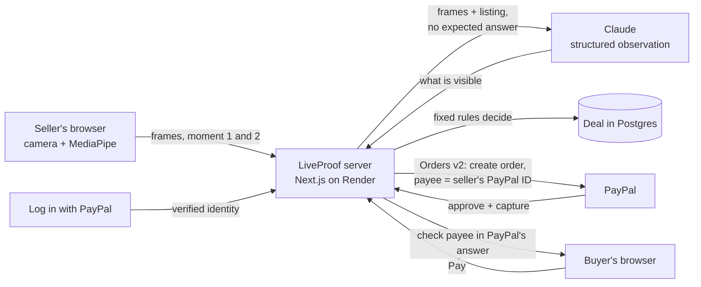

# LiveProof

> Your PayPal payment only goes to the person who just proved, live on camera, that they have the item.

LiveProof is for people who buy from strangers on Reddit trading subs, Facebook Marketplace and forums. Before the buyer pays, the seller logs in with PayPal and does a one-minute live check with the item: a fresh code written by hand, a gesture, and a surprise gesture. Claude checks the frames, fixed rules decide, and the buyer gets a link that can only pay the PayPal account that did the proof.

- **Live demo (PayPal sandbox):** https://liveproof-j5u7.onrender.com
- **Video (under 3 min):** _link added on submission_
- Built for the [PayPal AI Hackathon 2026](https://paypalaihackathon.devpost.com/). MIT license.

## The problem

On r/hardwareswap, a buyer about to pay $450 for a used graphics card asks for a "timestamp": a photo of the item next to a note with the seller's username and the date. Then they pay with PayPal Goods & Services. In October 2026 the moderators wrote that this is breaking down:

- [Oct 8, 2026](https://www.reddit.com/r/hardwareswap/comments/1x0elgx/official_were_considering_retiring_buying_posts/): "more trades originating from Buying posts are fraudulent than legitimate", with scammers using compromised Reddit and PayPal accounts.
- [Oct 25, 2026](https://www.reddit.com/r/hardwareswap/comments/1xfh2yu/update_on_buying_posts_and_timestamp_requirements/): "With the rise of AI timestamps, and compromised accounts, scams are becoming more regular."

Their new rule asks sellers for a video of at least 15 seconds. A video can still be recorded in advance, copied from someone else, or generated, and nothing ties it to the PayPal account that asks for the money. In one [r/paypal case](https://www.reddit.com/r/paypal/comments/1rzx9cn/scammed_for_56k_via_gs_paypal_sided_with_scammer/) a buyer lost $5,600 after the scammer "sends a new invoice from a different PayPal account".

## What LiveProof does

1. **The seller logs in with PayPal.** LiveProof reads the verified identity from Log in with PayPal (name, email, verified status and PayPal account ID).
2. **The seller pastes their listing.** Claude reads it and picks one physical detail of that item to show on camera.
3. **Live proof, in the browser.** LiveProof shows a random 5-character code only once the camera is on. The seller writes it on paper, holds it next to the item and makes a gesture. Then LiveProof reveals a surprise gesture, with 15 seconds to show it.
4. **Verification.** Claude describes what is in the frames without being told the expected code or gestures. Fixed rules in code compare that report with the challenge and decide.
5. **Buyer link.** The buyer sees the proof frames, the checks and the verified PayPal account. When they press Pay, LiveProof creates the PayPal order on the server with that account as the payee. After the capture it reads PayPal's answer and confirms the money went to the account that did the proof.

<a id="try-it"></a>
## Try it (PayPal sandbox, no real money)

Open https://liveproof-j5u7.onrender.com and press **Sell with a live proof**. The demo runs on Render's free plan: the first page can take up to a minute while the server wakes up.

| Role | Sandbox account | Password |
|---|---|---|
| Seller (logs in with PayPal on `/sell`) | `sb-94ici53757812@personal.example.com` | `TODO` |
| Buyer (pays on the buyer link) | `sb-bdtqz53757811@personal.example.com` | `TODO` |

1. Log in with PayPal using the seller account.
2. Paste a short listing for something you have at hand, for example `Selling my Logitech wireless mouse, works perfectly, $25 shipped`. Any object works.
3. On a computer you can do the proof with the webcam, or scan the QR code to continue on your phone, where the back camera can look down at the table.
4. Write the code on a piece of paper, hold it next to the item and follow the gestures.
5. Create the buyer link, open it, press **Pay with PayPal** and log in with the buyer account.

Tips: good light helps, and write the code big. If PayPal's sandbox login loops with "something went wrong", choose "Change" and log in again.

## How it works



### PayPal
- **Log in with PayPal (Identity API).** Scopes `openid profile email https://uri.paypal.com/services/paypalattributes`. LiveProof reads `payer_id`, `name`, `email` and `verified_account` from `/v1/identity/oauth2/userinfo` and keeps them in a signed, httpOnly session cookie.
- **Orders v2.** The order is created on the server with `purchase_units[].payee.merchant_id` set to the seller's `payer_id` (with the verified email as a fallback), `intent: CAPTURE` and the deal id in `custom_id`. The request from the buyer carries no payee at all, so a copied or edited link cannot redirect the money.
- **Capture and check.** After approval the server captures the order (idempotent with `PayPal-Request-Id`), checks that `custom_id` belongs to the deal and compares the payee in PayPal's response with the account that did the proof. The buyer page shows the capture id, the payee and PayPal's seller protection status.
- Code: [`src/lib/paypal.ts`](src/lib/paypal.ts), [`src/app/api/deal/[id]/pay/route.ts`](src/app/api/deal/%5Bid%5D/pay/route.ts), [`src/app/api/deal/[id]/return/route.ts`](src/app/api/deal/%5Bid%5D/return/route.ts).

### AI
| Tool | What it does in LiveProof |
|---|---|
| **Claude Opus 5.5** (`claude-opus-5-5`, Anthropic API) | Reads the pasted listing into structured fields (item, price, currency) and picks a physical detail to show on camera. |
| **Claude Opus 5.5** | The vision step. It receives the frames of both moments and the listing, and returns a structured observation: the handwritten code it reads, where the code is (paper or screen), the gesture in each moment, whether the item matches the listing, whether it is a real object or a screen, and whether both moments are the same scene. |
| **MediaPipe Gesture Recognizer** (in the browser) | Only picks the moment to capture the frames, when the requested gesture is held. It decides nothing. |

Design choices that keep the model honest:
- **Claude is never told the expected code or gestures,** so it cannot be nudged into "seeing" them. It reports what it sees; [`decide()`](src/lib/verify.ts) compares that with the challenge.
- **Code decides, not the model.** The random code and gestures come from `crypto`, the timing is measured on the server, and the pass/fail rules are fixed.
- **Structured outputs** (Zod schemas) for both calls; the frames are treated as untrusted content.
- **Honest to the buyer:** when Claude can confirm the kind of item but not the exact model, the buyer page says so.

We also used Claude Code as a coding assistant while building the project.

## Evaluation

The hard part is the live verification, so we measure it. [`scripts/eval.ts`](scripts/eval.ts) replays recorded attempts through the same `observe()` + `decide()` code and reports how many genuine proofs pass, how many fakes are rejected (by type), the time and the cost.

The set mixes real attempts recorded with the app and attacks built from them ([`scripts/derive-attacks.ts`](scripts/derive-attacks.ts)): a real proof replayed for a new code, real frames checked against a different item or another model of the same kind, wrong gestures, and real photos edited to show the new code. The frames show the people who recorded them, so they are not in this repository.

_Results are added here once the set is recorded._

```bash
npm run eval -- ../eval/attempts                      # default model (Opus 5.5)
npm run eval -- ../eval/attempts --model claude-haiku-5-5
```

## Security and privacy
- API keys live in environment variables only.
- A buyer link stores one frame per moment, so the buyer can see the proof. Nothing else from the camera is kept.
- Eval capture is off by default. It can only be turned on for listed PayPal accounts (`EVAL_CAPTURE_SELLERS`), which we used for our own sandbox test account.
- `MAX_CLAUDE_CALLS_PER_DAY` caps the AI checks per day so the public demo cannot run up the bill.

## Limitations
- LiveProof does not detect AI images. It makes a proof expensive to fake: fresh, physical, timed and tied to the account that gets paid.
- From one webcam frame, Claude can often confirm the kind of item but not the exact model. The buyer is told when that happens, and the requested detail (a model sticker, a serial label) is there to close the gap.
- Someone who once had the item could prepare frames in advance. The surprise gesture and the 15-second window make that much harder, not impossible.
- Sandbox only. Challenges live in memory on a single server instance.

## Run it locally

```bash
cp .env.example .env.local   # PayPal sandbox app keys, Anthropic API key
npm install
npm run dev
```

PayPal does not accept a `localhost` return URL for Log in with PayPal, so locally `DEV_FAKE_SELLER=1` stands in for the login (see `.env.example`). The full login runs on the deployed URL.

Stack: Next.js 16, React 19, Tailwind 4, `@anthropic-ai/sdk`, `@mediapipe/tasks-vision`, Neon Postgres, Render.

## License
MIT
