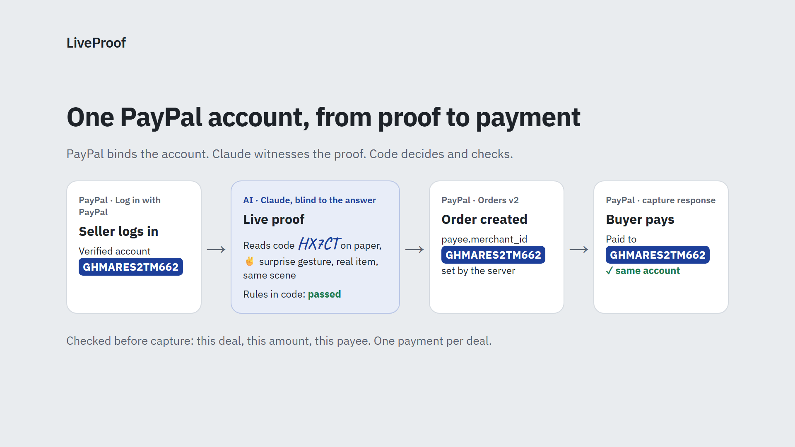
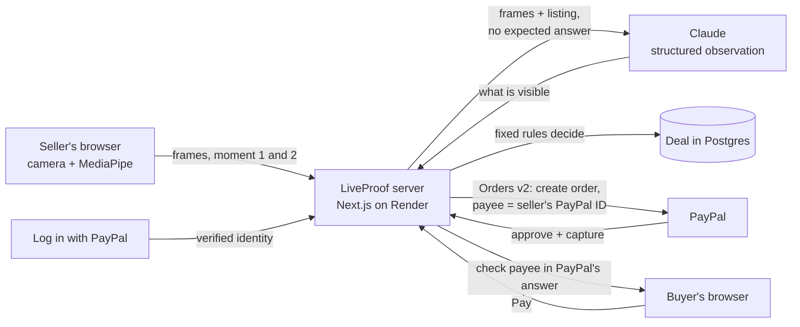

# LiveProof

> Your PayPal payment only goes to the person who just proved, live on camera, that they have the item.

LiveProof is for people who buy from strangers on Reddit trading subs, Facebook Marketplace and forums. Before the buyer pays, the seller logs in with PayPal and does a one-minute live check with the item: a fresh code written by hand, a gesture, and a surprise gesture. Claude checks the frames, fixed rules decide, and the buyer gets a link that can only pay the PayPal account that did the proof.

- **Live demo (PayPal sandbox):** https://liveproof-j5u7.onrender.com
- **Video (under 3 min):** _link added on submission_
- Built for the [PayPal AI Hackathon 2026](https://paypalaihackathon.devpost.com/). MIT license.

## The problem

On r/hardwareswap, a buyer about to pay $450 for a used graphics card asks for a "timestamp": a photo of the item next to a note with the seller's username and the date. Then they pay with PayPal Goods & Services. In October 2026 the moderators wrote that this is breaking down:

- [Oct 8, 2026](https://www.reddit.com/r/hardwareswap/comments/1x0elgx/official_were_considering_retiring_buying_posts/): "more trades originating from Buying posts are fraudulent than legitimate", with scammers using compromised Reddit and PayPal accounts.
- [Oct 25, 2026](https://www.reddit.com/r/hardwareswap/comments/1xfh2yu/update_on_buying_posts_and_timestamp_requirements/): "With the rise of AI timestamps, and compromised accounts, scams are becoming more regular."

Their new rule asks sellers for a video of at least 15 seconds. A video can still be recorded in advance, copied from someone else, or generated, and nothing ties it to the PayPal account that asks for the money. In one [r/paypal case](https://www.reddit.com/r/paypal/comments/1rzx9cn/scammed_for_56k_via_gs_paypal_sided_with_scammer/) a buyer lost $5,600 after the scammer "sends a new invoice from a different PayPal account".

## What LiveProof does

1. **The seller logs in with PayPal.** LiveProof reads the seller's identity from Log in with PayPal (name, email, PayPal account ID, and whether PayPal has verified the account) and shows the verified status to the buyer.
2. **The seller pastes their listing.** Claude reads it and picks one physical detail of that item to show on camera.
3. **Live proof, in the browser.** LiveProof generates a random 5-character code when the seller starts the proof, with the camera on. The seller writes it on paper, holds it next to the item and makes a gesture. Then LiveProof reveals a surprise gesture, with 15 seconds to show it.
4. **Verification.** Claude describes what is in the frames without being told the expected code or gestures. Fixed rules in code compare that report with the challenge and decide.
5. **Buyer link.** The buyer sees the proof frames, what Claude reported, the checks, how many failed attempts came before, and the PayPal account. When they press Pay, LiveProof creates the PayPal order on the server with that account as the payee. When the buyer comes back from PayPal, LiveProof checks the order (this deal, this amount, this payee) before capturing it, and shows the account that did the proof next to the account PayPal says it paid.

<a id="try-it"></a>
## Try it (PayPal sandbox, no real money)

Open https://liveproof-j5u7.onrender.com and press **Sell with a live proof**. The demo runs on Render's free plan: the first page can take up to a minute while the server wakes up.

| Role | Sandbox account | Password |
|---|---|---|
| Seller (logs in with PayPal on `/sell`) | `sb-94ici53757812@personal.example.com` | `TODO` |
| Buyer (pays on the buyer link) | `sb-bdtqz53757811@personal.example.com` | `TODO` |

1. Log in with PayPal using the seller account.
2. Paste a short listing for something you have at hand, for example `Selling my Logitech wireless mouse, works perfectly, $25 shipped`. Any object works.
3. On a computer you can do the proof with the webcam, or scan the QR code to continue on your phone, where the back camera can look down at the table.
4. Write the code on a piece of paper, hold it next to the item and follow the gestures.
5. Create the buyer link, open it, press **Pay with PayPal** and log in with the buyer account.

Tips: good light helps, and write the code big. If PayPal's sandbox login loops with "something went wrong", choose "Change" and log in again.

## How it works





### PayPal
- **Log in with PayPal (Identity API).** Scopes `openid profile email https://uri.paypal.com/services/paypalattributes`. LiveProof reads `payer_id`, `name`, `email` and `verified_account` from `/v1/identity/oauth2/userinfo` and keeps them in a signed, httpOnly session cookie.
- **Orders v2.** The order is created on the server with `purchase_units[].payee.merchant_id` set to the seller's `payer_id` (with the verified email as a fallback), `intent: CAPTURE` and the deal id in `custom_id`. The request from the buyer carries no payee at all, so a copied or edited link cannot redirect the money.
- **Check, then capture.** When the buyer returns, the server reads the order and checks `custom_id`, the amount, the currency and the payee against the deal. Only then it captures (idempotent with `PayPal-Request-Id`) and branches on the capture status: `COMPLETED` is shown as paid, `PENDING` as pending, and a payee mismatch in red, never as paid. The buyer page shows the capture id, the payee and PayPal's seller protection status.
- **The proof travels with the PayPal transaction.** The order's item links to the live proof and uses its first frame as the item image, so the buyer sees the proof on PayPal's own checkout too.
- **Shipment tracking (Orders v2 `/track`).** After the payment, the seller (logged in with the same PayPal account) adds the carrier and tracking number on the deal page. LiveProof registers it on the PayPal order with `notify_payer` and the item linked to the proof; shipping with tracking to the address on the transaction is what PayPal Seller Protection asks for.
- **One payment per deal.** The order carries `invoice_id`, the payment is recorded with a conditional update, and pressing Pay again reuses or settles the order the buyer already has. If something fails after PayPal may have taken the money, the buyer is told not to pay again, and the deal page reconciles with PayPal (`GET` order) on its next load. There are no webhooks yet.
- Code: [`src/lib/paypal.ts`](src/lib/paypal.ts), [`src/lib/settle.ts`](src/lib/settle.ts), [`src/app/api/deal/[id]/pay/route.ts`](src/app/api/deal/%5Bid%5D/pay/route.ts), [`src/app/api/deal/[id]/return/route.ts`](src/app/api/deal/%5Bid%5D/return/route.ts).

### AI
| Tool | What it does in LiveProof |
|---|---|
| **Claude Opus 5.5** (`claude-opus-5-5`, Anthropic API) | Reads the pasted listing into structured fields (item, price, currency) and picks a physical detail to show on camera. |
| **Claude Opus 5.5** | The vision step. It receives the frames of both moments and the listing, and returns a structured observation: the handwritten code it reads, where the code is (paper or screen), the gesture in each moment, whether the item matches the listing, whether it is a real object or a screen, and whether both moments are the same scene. |
| **MediaPipe Gesture Recognizer** (in the browser) | Only picks the moment to capture the frames, when the requested gesture is held. It decides nothing. |

Design choices that keep the model honest:
- **Claude is never told the expected code or gestures,** so it cannot be nudged into "seeing" them. It reports what it sees; [`decide()`](src/lib/verify.ts) compares that with the challenge.
- **Claude perceives, code decides.** The random code and gestures come from `crypto`, the timing is measured on the server, and the pass/fail rules are fixed code. What Claude contributes is perception: the code it reads, the gestures it sees, whether the item matches, whether it is a real object and the same scene. Those labels are what the rules compare.
- **Model labels.** When Claude can read a model label on the item, it copies the text and code compares it with the model in the listing.
- **Structured outputs** (Zod schemas) for both calls; the frames are treated as untrusted content.
- **Honest to the buyer:** both pages show what Claude reported, separately from the rules. When Claude can confirm the kind of item but not the exact model, or the label differs from the listing, the check shows in amber, not as a green tick.

Claude Code was used as a coding assistant while building the project.

## Evaluation

The hard part is the live verification, so it is measured. [`scripts/eval.ts`](scripts/eval.ts) replays recorded attempts through the same `observe()` + `decide()` code and reports how many genuine proofs pass, how many fakes are rejected (by type), the time and the cost.

The set mixes real attempts recorded with the app (genuine ones and physical attacks, like the item shown on a phone screen) with attacks built from the real frames:
- [`scripts/derive-attacks.ts`](scripts/derive-attacks.ts): a real proof replayed for a new code, real frames checked against a different item or another model of the same kind, and a different gesture asked than the one shown. The replay and wrong-gesture cases mostly test that Claude reads codes and gestures correctly.
- [`scripts/edit-code.py`](scripts/edit-code.py): real proof photos with the code painted over and a new code written in a handwriting-style font. This is a simple edit, not an AI image model.

The frames show the people who recorded them, so they are not in this repository.

_Results are added here once the set is recorded._

```bash
npm run eval -- ../eval/attempts                      # default model (Opus 5.5)
npm run eval -- ../eval/attempts --model claude-haiku-5-5
```

## Security and privacy
- API keys live in environment variables only.
- A buyer link stores one frame per moment, so the buyer can see the proof. Nothing else from the camera is kept.
- Eval capture is off by default. It can only be turned on for listed PayPal accounts (`EVAL_CAPTURE_SELLERS`); it was used only for the project's own sandbox test account.
- `MAX_CLAUDE_CALLS_PER_DAY` and `MAX_CLAUDE_CALLS_PER_IP` cap the AI checks per day, overall and per visitor, so the public demo cannot run up the bill or be used up by one person.
- The buyer page shows how many failed live proofs the same account made in the hour before the one that passed.

## Limitations
- LiveProof does not detect AI images. It makes a proof expensive to fake: fresh, physical, timed and tied to the account that gets paid.
- From one webcam frame, Claude can often confirm the kind of item but not the exact model. The buyer is told when that happens, and the requested detail (a model sticker, a serial label) is there to close the gap.
- Someone who once had the item could prepare frames in advance: one with the item and paper for the code, and one for each possible surprise gesture, then edit the new code in within the 2-minute window. The handwriting check, the 15-second window and the visible count of failed attempts make that harder, not impossible. A browser cannot prove the frames came from a real camera.
- Sandbox only. Challenges live in memory on a single server instance.

## Run it locally

```bash
cp .env.example .env.local   # PayPal sandbox app keys, Anthropic API key
npm install
npm run dev
```

PayPal does not accept a `localhost` return URL for Log in with PayPal, so locally `DEV_FAKE_SELLER=1` stands in for the login (see `.env.example`). The full login runs on the deployed URL.

Stack: Next.js 16, React 19, Tailwind 4, `@anthropic-ai/sdk`, `@mediapipe/tasks-vision`, Neon Postgres, Render.

## License
MIT
